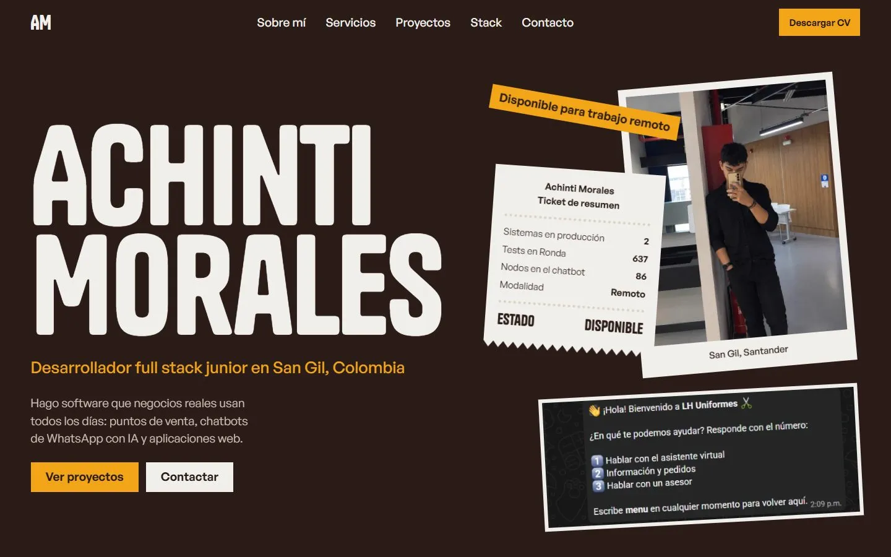
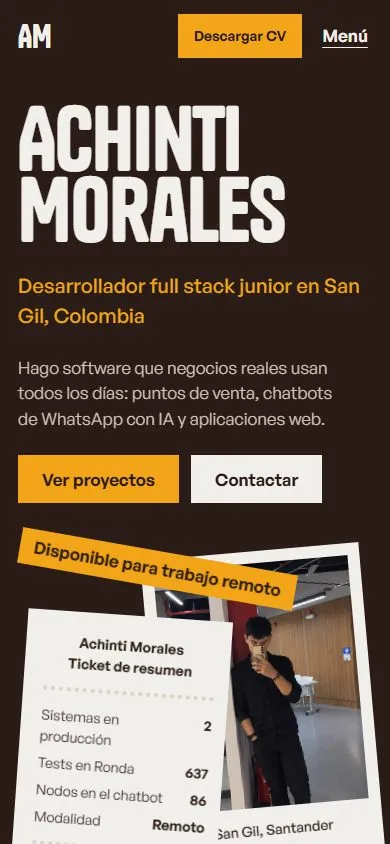

# Achinti Morales · Portafolio

Portafolio profesional one page de **Achinti Morales Hernández**, Junior Full Stack Developer con software propio en producción para clientes reales.

**🔗 Sitio en vivo:** [achinti24.github.io](https://achinti24.github.io/)



<p align="center">
  
</p>

## Descripción

Sitio estático dirigido a reclutadores de empresas remotas y a posibles clientes. Presenta los servicios que ofrezco y los proyectos como casos de estudio, empezando por los dos sistemas que clientes reales usan a diario (un POS con inventario y el chatbot de pedidos de LH Uniformes) y por Ronda, el POS para restaurantes que estoy terminando.

**Secciones:** Portada, Sobre mí (con experiencia y formación), Servicios, Proyectos, Stack, Contacto y pie.

## Tecnologías

- **HTML5 semántico**: `header`, `nav`, `main`, `section`, `article`, `aside`, `footer`, con un solo `h1` y una jerarquía de títulos correcta.
- **CSS3**: variables (design tokens), Grid, Flexbox, `clamp()` para tipografía fluida y enfoque mobile-first.
- **JavaScript vanilla** (ES2020+): sin frameworks, librerías ni dependencias.
- Fuentes auto-alojadas en woff2: Tanker y General Sans, de Fontshare (ITF Free Font License).

## Estructura

```
├── index.html
├── css/
│   └── styles.css        # tokens, reset, piezas del collage y secciones
├── js/
│   └── main.js           # módulos pequeños inicializados desde init()
└── assets/
    ├── cv/               # hojas de vida en PDF (Full Stack, Frontend, Backend, Automatización e IA)
    ├── fonts/            # fuentes woff2 y licencia de Fontshare
    ├── images/           # fotos, capturas de los proyectos, imagen Open Graph y capturas del sitio
    ├── favicon.svg
    └── apple-touch-icon.png
```

## Diseño

Un collage de piezas reales sobre un campo de chocolate oscuro: polaroids, un ticket térmico como los que imprimen mis sistemas, capturas del chatbot y la pantalla de cocina de Ronda. Cada proyecto tiene su propio panel de color.

| Token | Color | Uso | Contraste |
|---|---|---|---|
| `--ink` | `#2A1D17` | Fondo principal | — |
| `--paper` | `#F1EFEA` | Texto sobre fondo oscuro, polaroids y tickets | 14.2 : 1 sobre `--ink` |
| `--bone` | `#E5E1D8` | Secciones claras | — |
| `--muted` | `#5F5048` | Texto secundario sobre claro | 5.4 : 1 sobre `--bone` |
| `--accent` | `#F2A516` | Acento mango: botones, franja y stickers | 8.6 : 1 con `--ink` encima |

Todas las combinaciones de texto cumplen **WCAG AA** (≥ 4.5 : 1).

**Tipografía:** Tanker para títulos y General Sans para el texto.

## Funcionalidades

- Navegación con anclas, resaltado de la sección activa y menú de teléfono accesible (`aria-expanded`, cierre con `Escape`, con un clic fuera o al elegir un enlace).
- Franja de servicios en movimiento y piezas del collage que se enderezan al pasar el cursor.
- Cupón de contacto: eliges la vacante y descargas la hoja de vida que corresponde, con una sugerencia de qué proyectos mirar primero. Sin JavaScript descarga la versión Full Stack.
- Botón para copiar el email con aviso accesible (`role="status"`).

## Accesibilidad y rendimiento

- Enlace "Saltar al contenido", foco visible en todos los controles y textos ocultos para lectores de pantalla en enlaces externos.
- Respeta `prefers-reduced-motion`: sin franja en movimiento, entradas ni animaciones de la portada.
- Imágenes WebP con `width`/`height`, `alt` descriptivo y `loading="lazy"` fuera de la portada.
- Fuentes precargadas con `font-display: swap`.
- Meta tags de SEO, Open Graph y Twitter Card, favicon SVG y `lang="es"`.

## Flujo de trabajo con Git

El proyecto sigue **Git Flow**:

- `main`: versión publicada en GitHub Pages.
- `develop`: integración.
- `feature/*`: una rama por sección (`base-structure`, `design-tokens`, `header-nav`, `hero`, `about`, `skills`, `projects`, `education`, `contact`, `responsive`, `readme`), fusionada en `develop` con `--no-ff`.
- `release/1.0.0`: fusionada en `main` y `develop` con `--no-ff` y etiquetada como `v1.0.0`.

Commits pequeños en inglés con **Conventional Commits + gitmoji**, por ejemplo: `✨ feat: add hero section with CTA buttons and profile photo`.

## Ejecutar en local

No requiere instalación. Basta con servir la carpeta con cualquier servidor estático:

```bash
python3 -m http.server 8000
# abrir http://localhost:8000
```

## Contacto

- Email: [achintimorales@gmail.com](mailto:achintimorales@gmail.com)
- GitHub: [@achinti24](https://github.com/achinti24)
- LinkedIn: [Achinti Morales Hernández](https://www.linkedin.com/in/achinti-morales-hern%C3%A1ndez-879172338/)
