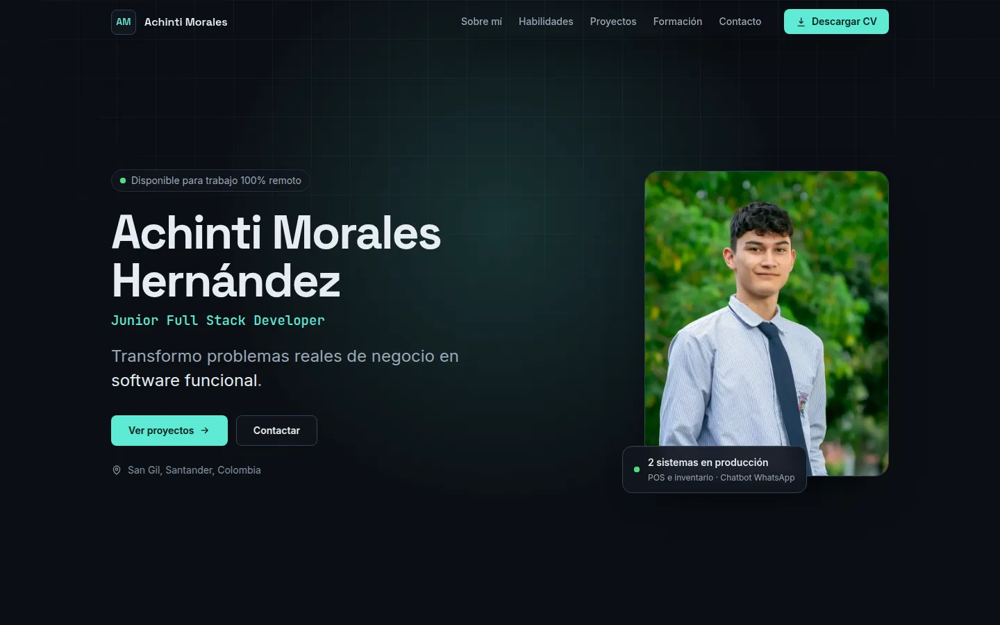
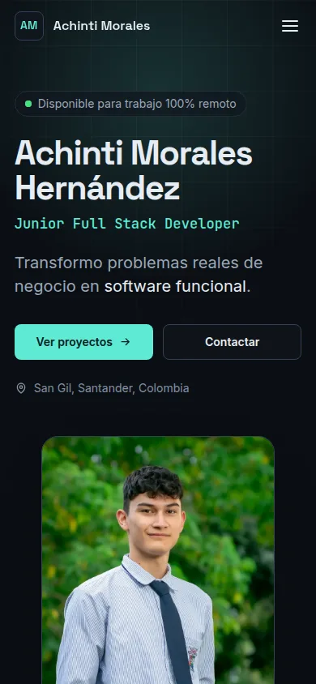

# Achinti Morales · Portafolio

Portafolio profesional one page de **Achinti Morales Hernández**, Junior Full Stack Developer con software propio en producción para clientes reales.

**🔗 Sitio en vivo:** [achinti24.github.io](https://achinti24.github.io/)



<p align="center">
  
</p>

## Descripción

Sitio estático dirigido a reclutadores de empresas remotas y a posibles clientes. Presenta los proyectos como casos de estudio (**problema → solución → stack**), destacando los dos sistemas que clientes reales usan a diario: un POS con inventario y un chatbot de pedidos por WhatsApp.

**Secciones:** Hero · Sobre mí · Habilidades · Proyectos · Formación y experiencia · Contacto · Footer.

## Tecnologías

- **HTML5 semántico**: `header`, `nav`, `main`, `section`, `article`, `aside`, `footer`, con un solo `h1` y una jerarquía de títulos correcta.
- **CSS3**: variables (design tokens), Grid, Flexbox, `clamp()` para tipografía fluida y enfoque mobile-first.
- **JavaScript vanilla** (ES2020+): sin frameworks, librerías ni dependencias.
- Fuentes auto-alojadas en woff2 variable: Space Grotesk, Inter y JetBrains Mono (licencia OFL).

## Estructura

```
├── index.html
├── css/
│   └── styles.css        # tokens → reset → base → layout → componentes → secciones
├── js/
│   └── main.js           # módulos pequeños inicializados desde init()
└── assets/
    ├── cv/               # hojas de vida en PDF (Full Stack, Frontend, Backend, Automatización e IA)
    ├── fonts/            # fuentes woff2 + licencias OFL
    ├── images/           # imágenes WebP, imagen Open Graph y capturas
    ├── favicon.svg
    └── apple-touch-icon.png
```

## Diseño

Estética de producto SaaS oscura y técnica: cuadrícula sutil, un solo color de acento y detalles en tipografía monoespaciada.

| Token | Color | Uso | Contraste sobre fondo |
|---|---|---|---|
| `--bg` | `#0B0F14` | Fondo | — |
| `--surface` | `#11161E` | Tarjetas | — |
| `--text` | `#E6EDF3` | Texto principal | 16.3 : 1 |
| `--text-muted` | `#9AA8B8` | Texto secundario | 7.9 : 1 |
| `--text-subtle` | `#8391A3` | Etiquetas | 6.0 : 1 |
| `--accent` | `#5EEAD4` | Acento, enlaces, foco | 13.0 : 1 |

Todas las combinaciones de texto cumplen **WCAG AA** (≥ 4.5 : 1).

**Tipografía:** Space Grotesk (títulos) · Inter (texto) · JetBrains Mono (etiquetas y chips).

## Funcionalidades

- Header fijo que gana fondo translúcido al hacer scroll.
- Navegación con anclas, scroll suave y **resaltado de la sección activa** (`IntersectionObserver`).
- **Menú hamburguesa accesible**: `aria-expanded`, `aria-controls`, cierre al elegir un enlace, con `Escape` (devuelve el foco al botón) o con un clic fuera.
- Microinteracciones: aparición al hacer scroll, brillo que sigue al cursor en las tarjetas y animación de entrada del hero.
- Botón **Copiar email** con aviso accesible (`role="status"` / `aria-live`).
- Descarga de 4 hojas de vida según el tipo de vacante.

## Accesibilidad y rendimiento

- Enlace "Saltar al contenido", estados `:focus-visible` visibles y textos ocultos para lectores de pantalla en enlaces externos.
- Respeta `prefers-reduced-motion`: sin animaciones de entrada, reveal ni brillo del cursor.
- Imágenes WebP con `width`/`height` (sin saltos de diseño), `alt` descriptivo y `loading="lazy"` fuera del hero.
- Fuentes precargadas con `font-display: swap`.
- Meta tags de SEO, Open Graph y Twitter Card, favicon SVG y `lang="es"`.
- HTML validado con `html-validate` (preset recomendado) sin errores.

## Flujo de trabajo con Git

El proyecto sigue **Git Flow**:

- `main`: versión publicada en GitHub Pages.
- `develop`: integración.
- `feature/*`: una rama por sección (`base-structure`, `design-tokens`, `header-nav`, `hero`, `about`, `skills`, `projects`, `education`, `contact`, `responsive`, `readme`), fusionada en `develop` con `--no-ff`.
- `release/1.0.0`: fusionada en `main` y `develop` con `--no-ff` y etiquetada como `v1.0.0`.

Commits pequeños en inglés con **Conventional Commits + gitmoji**, por ejemplo: `✨ feat: add hero section with CTA buttons and profile photo`.

## Ejecutar en local

No requiere instalación. Basta con servir la carpeta con cualquier servidor estático:

```bash
python3 -m http.server 8000
# abrir http://localhost:8000
```

## Contacto

- Email: [achintimorales@gmail.com](mailto:achintimorales@gmail.com)
- GitHub: [@achinti24](https://github.com/achinti24)
- LinkedIn: [Achinti Morales Hernández](https://www.linkedin.com/in/achinti-morales-hern%C3%A1ndez-879172338/)
